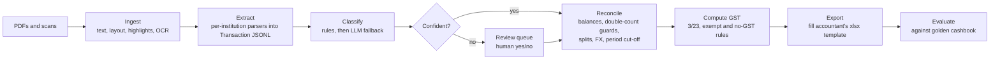

# cashbook-agent

**An agentic pipeline that turns bank, card and wallet statements plus supplier invoices into a completed, accountant-ready GST cashbook.**

The tax maths is deterministic. An LLM is used only where judgment is needed, a human approves anything the agent is unsure about, and an evaluation harness measures accuracy against a hand-checked answer key.

---

## The problem

A one-person New Zealand consulting company files GST every six months. Each period someone has to:

- read 5–7 statements from four institutions, each in a different PDF layout (bank transaction lists, credit cards, a share-platform spend account), plus scanned supplier invoices
- pick out the business transactions, some of them marked with a yellow highlighter
- code each one to the accountant's chart (income, power, internet, mobile, car parking, home office, no-GST offshore subscriptions, and so on)
- handle the traps:
  - card repayments that would double-count card purchases
  - utility bills that combine power (25% business) with internet (100% business)
  - foreign-currency charges with separate FX and offshore fees
  - credits carried between invoices
  - purchases that fall just outside the period
- fill the accountant's existing Excel template, with its formulas intact, so the totals reconcile

Done by hand with an AI chat assistant, this took about half a day. Most of that was cross-checking rather than typing.

## Goals

1. Produce the accountant's **own xlsx template**, filled in, with no layout changes.
2. Make every figure **traceable** to a source file, page and line.
3. Measure accuracy against a **hand-checked golden cashbook**, reported honestly.
4. Run **locally**, so real financial data never leaves the machine unless explicitly configured.
5. Ask a human only when it matters: low-confidence classifications and policy questions.

**Non-goals for phase 1:** lodging with Inland Revenue, income tax or provisional tax, company annual accounts, and multi-user or SaaS use.

## Design principles

| Principle | What it means here |
|---|---|
| Deterministic first | Rules and arithmetic decide. The LLM only proposes a classification for unknown items, with a confidence score and reasons. |
| Provenance everywhere | Each cashbook line records its source file, page, bounding box, raw text and the rule or model that classified it. |
| Human in the loop | Anything below the confidence threshold, or any policy question (for example "is this café business?"), goes to a review queue. |
| Untrusted input | Merchant descriptions and PDF text are data, never instructions. The LLM sees redacted, structured fields and must return schema-validated output. |
| Private by default | Real statements live in a git-ignored `private/` folder. The public repo, its tests and CI use synthetic statements in the same layouts. |
| Honest evals | Results are reported for rules-only and rules-plus-LLM runs, including failures, cost and review load. |

## Pipeline

## Stack

- **Language and platform:** Java 21, Quarkus 3.x (command mode with Picocli), Gradle (Kotlin DSL), `nz.co.ksktech`
- **Documents:** Apache PDFBox for text, layout and page rendering for highlight detection; Tess4J (Tesseract) for scanned invoices; Apache POI for the xlsx template and formula evaluation
- **LLM:** LangChain4j with structured outputs, switchable between Claude (API) and a local model (Ollama)
- **Engineering:** JSONL structured logging with correlation IDs, WireMock for offline LLM tests, Docker

## Phases

| Phase | What happens | Exit criteria |
|---|---|---|
| **1. Shadow mode** (period Oct 2026 – Mar 2027) | The agent produces a cashbook in parallel with the existing manual process, and the two are compared line by line. | At least 95% line-level code accuracy; GST collected and GST claimed each within $1 of the hand-checked cashbook; every statement reconciles |
| **2. Self-filed GST** | Once two consecutive periods match the accountant's figures, the agent also produces the figures needed for the IRD GST return, entered manually in myIR. The accountant still handles the annual accounts. | Accountant signs off the agent's numbers for one full period |
| **3. Showcase** | Public repo with synthetic data, an evaluation report, a write-up and a demo. Optional: an MCP server exposing the pipeline as tools, and a Telegram review channel. | Repo, write-up and demo published |

## Success metrics

- Line-level classification accuracy, plus precision and recall for each code
- Dollar difference for each code, and difference in GST collected and claimed, against the golden cashbook
- Statement reconciliation: opening balance plus money in minus money out equals the closing balance
- Review load: the number of items a human had to decide
- Wall-clock time and LLM cost per period

## Risks and mitigations

| Risk | Mitigation |
|---|---|
| A bank changes its PDF layout | Contract tests for each parser; an LLM-based fallback extractor whose output is always flagged for review |
| Tax rules are wrong or change | Rules are versioned config reviewed by the accountant. The agent never files anything itself. |
| Private data leaks into the repo or prompts | `private/` is git-ignored; account numbers are redacted before LLM calls; a local-model option; synthetic fixtures for CI |
| Prompt injection through merchant text | Structured fields only, schema-validated outputs, and an allow-listed code set |

## What this demonstrates

- An agent design that knows where **not** to use the LLM
- A human-in-the-loop design with a measurable review load
- Document AI on real-world messy inputs: layouts, highlights and scans
- An evaluation harness with an answer key and honest reporting
- A privacy-preserving engineering practice: synthetic data, redaction and a local inference option
